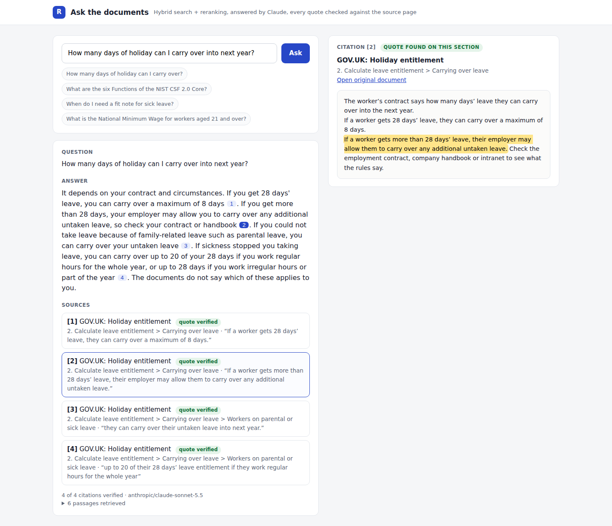
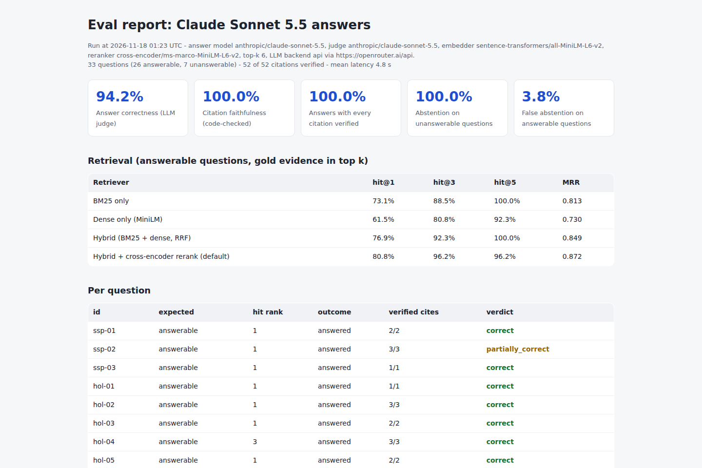
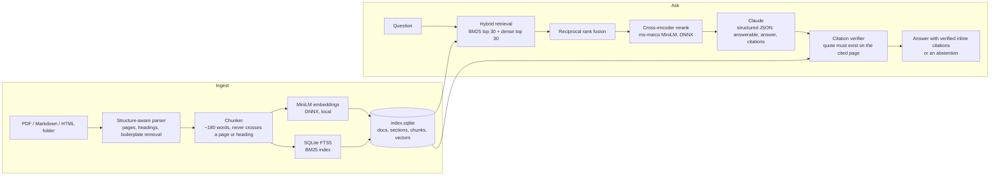
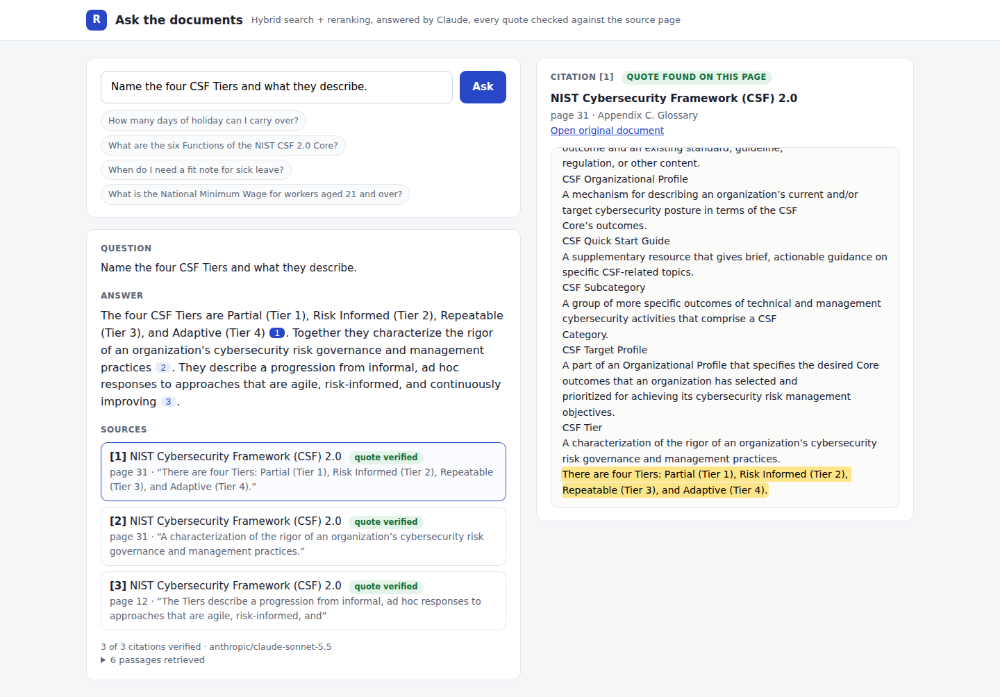
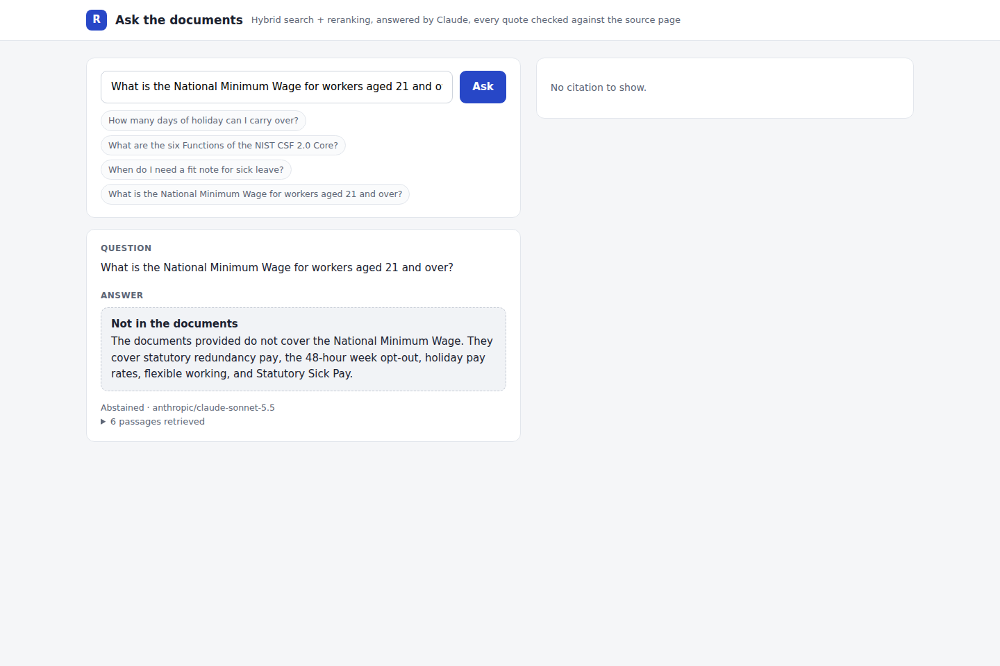

# rag-with-citations

**Chat with your company documents, with every answer cited to the page and every quote checked in code.**

Point it at a folder of PDFs, Markdown and HTML. Ask a question in plain English. You get a short answer where each sentence carries an inline citation like `[1]`; clicking it opens the exact passage, with the quoted words highlighted, and a link to the original document at that page. When the documents do not contain the answer, it says so instead of guessing.

The repository ships the eval suite too: a public corpus, 33 questions, and a report that measures retrieval, citation faithfulness, answer correctness and abstention. The numbers below come from a real run, saved in [`docs/eval/`](docs/eval/).



## The business problem

Most "chatbot trained on your documents" demos fail in the same three ways:

1. **Made-up answers.** The model fills gaps from its general knowledge, so a policy question gets a plausible answer that is not in your policy.
2. **Citations nobody can check.** A link to "handbook.pdf" does not tell a reader which sentence supports the claim, or whether any sentence does.
3. **No measurement.** Nobody knows how often it is right, so nobody can tell whether a change made it better or worse.

This project treats each of those as a requirement:

- Answers use only retrieved passages, and the model has an explicit "not in the documents" option.
- Every citation carries a **verbatim quote**, and code checks that the quote really appears on the cited PDF page or section. Unverified quotes are flagged in red, never shown as fact.
- An eval suite scores retrieval, faithfulness, correctness and abstention, and writes a Markdown and HTML report.

## Results

Measured on 2026-11-18 through the Anthropic Python SDK, over the public corpus described below (22 documents, 343 chunks): 33 questions, of which 26 are answerable from the corpus and 7 are deliberately not (they sit close to the corpus topics, for example asking for a fine amount the holiday guide mentions but never states). Judge model for correctness: Claude Sonnet 5.5 with the prompt in [`src/ragcite/prompts/judge.md`](src/ragcite/prompts/judge.md).

| Metric | Claude Sonnet 5.5 | Claude Haiku 5.5 |
|---|---|---|
| Answer correctness (LLM judge, answerable questions) | **94.2%** (24 correct, 1 partial, 1 incorrect) | **94.2%** (24 correct, 1 partial, 1 incorrect) |
| Citation faithfulness (quote found on the cited page, checked by code) | **100%** (52 of 52) | **96.8%** (61 of 63) |
| Answers where every citation verified | 100% | 96.0% |
| Abstention on unanswerable questions | **100%** (7 of 7) | **100%** (7 of 7) |
| False abstention on answerable questions | 3.8% (1 of 26) | 3.8% (1 of 26) |
| Mean latency per question (retrieval + answer, CPU retrieval, via gateway) | 4.8 s | 4.7 s |
| Tokens for all 33 answers (input / output) | 78,189 / 5,966 | 78,189 / 6,722 |

Retrieval only (no LLM involved), answerable questions, "hit" = a passage from the right document containing the gold evidence phrase:

| Retriever | hit@1 | hit@3 | hit@5 | MRR |
|---|---|---|---|---|
| BM25 only (SQLite FTS5) | 73.1% | 88.5% | 100% | 0.813 |
| Dense only (MiniLM-L6) | 61.5% | 80.8% | 92.3% | 0.730 |
| Hybrid (BM25 + dense, RRF) | 76.9% | 92.3% | 100% | 0.849 |
| Hybrid + cross-encoder rerank (default) | **80.8%** | **96.2%** | 96.2% | **0.872** |

What the run shows:

- **The one wrong answer is a retrieval miss, and the model refused to guess.** For "What was the Cybersecurity Framework called before version 2.0?" the reranker pushed the page with the old title out of the top 6 (plain hybrid had it in the top 5). Both models then said the passages do not give an earlier name instead of answering from their own knowledge. That is the behaviour you want from a policy assistant, and it is why the reranked retriever scores 96.2% at hit@5 against 100% for plain hybrid.
- **Reranking helps where it matters most**: the right passage is ranked first for 80.8% of questions, against 76.9% for plain hybrid and 61.5% for dense search alone.
- **Haiku's two unverified citations** quoted single table cells ("Respond", "Recover") from a NIST mapping table. The verifier rejects quotes under 8 characters because one word proves nothing, so they are flagged rather than counted as evidence. The answer itself was graded partially correct.
- **Haiku 5.5 matched Sonnet 5.5 on correctness and abstention** on this set, at a much lower price per token; Sonnet was cleaner on citations.

Full reports: [Sonnet 5.5 (Markdown)](docs/eval/sonnet-5-5/report.md), [Haiku 5.5 (Markdown)](docs/eval/haiku-5-5/report.md); the HTML versions and raw `results.json` sit next to them.



## How it works



- **Parsing** (`parsing.py`): PDFs are read page by page; running headers, footers and page numbers are dropped, and numbered headings ("3.1. CSF Profiles") start new sections. Markdown and HTML are split by heading, keeping the full heading path ("3. Eligibility > Fit notes"). Navigation, scripts and footers are removed from HTML.
- **Chunking** (`chunking.py`): paragraphs are packed into ~180-word passages with one paragraph of overlap. A chunk never spans two pages or two headings, so every citation has an exact location.
- **Index** (`store.py`): one SQLite file holds documents, citable sections, chunks, float32 vectors and an FTS5 BM25 index. No vector database to run.
- **Retrieval** (`retrieval.py`): BM25 and dense candidates are fused with reciprocal rank fusion, then the top 20 are reranked by a cross-encoder; the best 6 go to Claude.
- **Answering** (`answer.py`, prompt in `src/ragcite/prompts/answer_system.md`): Claude returns JSON through structured outputs: `answerable`, `answer` with `[n]` markers, and `citations` of `{source, quote}`. Passages are wrapped as data, and the prompt tells the model not to follow instructions found inside documents.
- **Verification** (`faithfulness.py`): each quote must appear, after light normalisation (case, whitespace, curly quotes, dashes, PDF line-break artefacts), both in the passage the model saw and in the stored text of the cited page or section. Words and numbers must match exactly; `...` may join two exact pieces in order.
- **Evaluation** (`evaluation.py`, `report.py`): see below.

Design decisions and their trade-offs are recorded in [`docs/ADR.md`](docs/ADR.md).

## Quickstart

Requires Python 3.11+. Embedding and reranking models (about 90 MB each, ONNX) download from the Hugging Face Hub on first use and run on CPU.

```bash
git clone https://github.com/mhmalvi/rag-with-citations.git
cd rag-with-citations
python -m venv .venv && source .venv/bin/activate
pip install -e ".[dev]"

# 1. Index a folder (the bundled public corpus, or your own documents)
ragcite ingest corpus/files

# 2. Set a key (never commit it; .env is git-ignored)
export ANTHROPIC_API_KEY=...            # direct Anthropic API

# 3. Ask from the command line
ragcite ask "How many days of holiday can I carry over?"

# 4. Or start the web UI on http://127.0.0.1:8000
ragcite serve

# 5. Run the eval suite and write docs/eval/<name>/report.{md,html}
ragcite eval --name my-run --out docs/eval/my-run

# Offline tests (no network, no key; the LLM and models are faked)
pytest
```

### Configuration

Everything is set with environment variables:

| Variable | Default | Meaning |
|---|---|---|
| `RAG_ANSWER_MODEL` | `claude-sonnet-5-5` | Model that writes answers |
| `RAG_JUDGE_MODEL` | `claude-sonnet-5-5` | Model that grades answers in `ragcite eval` |
| `RAG_BASE_URL` | Anthropic API | Base URL of any Anthropic-compatible endpoint |
| `RAG_API_KEY_ENV` | `ANTHROPIC_API_KEY` | Name of the env var that holds the key |
| `RAG_DB_PATH` | `.ragcite/index.sqlite` | Index file |
| `RAG_EMBED_MODEL` | `sentence-transformers/all-MiniLM-L6-v2` | Bi-encoder (Hub id or local dir with an ONNX export) |
| `RAG_RERANK_MODEL` | `cross-encoder/ms-marco-MiniLM-L6-v2` | Cross-encoder, or `none` to skip reranking |
| `RAG_FINAL_K` | `6` | Passages sent to Claude |
| `RAG_LLM_BACKEND` | `api` | `api` (Anthropic SDK) or `claude-cli` (a signed-in Claude Code CLI) |

It runs on the Anthropic API or on any Anthropic-compatible gateway. For example, through OpenRouter:

```bash
export OPENROUTER_API_KEY=...
export RAG_BASE_URL=https://openrouter.ai/api RAG_API_KEY_ENV=OPENROUTER_API_KEY
export RAG_ANSWER_MODEL=anthropic/claude-sonnet-5.5 RAG_JUDGE_MODEL=anthropic/claude-sonnet-5.5
```

## The eval suite

- **Question set**: [`evals/questions.jsonl`](evals/questions.jsonl). Each answerable item names its gold document, one or more short evidence phrases copied from that document, and a reference answer. A test (`tests/test_corpus_questions.py`) checks in CI that every evidence phrase still exists in the parsed corpus.
- **Retrieval hit@k / MRR**: does a passage from the gold document containing an evidence phrase appear in the top k? Measured for BM25, dense, hybrid and hybrid + rerank, with no LLM involved.
- **Citation faithfulness**: share of all citations whose quote is found on the cited page or section, checked by code (`faithfulness.py`), not by a model.
- **Answer correctness**: an LLM judge compares the answer with the reference answer and returns `correct`, `partially_correct` or `incorrect` (scored 1, 0.5, 0). Abstaining on an answerable question counts as incorrect without asking the judge.
- **Abstention accuracy**: share of unanswerable questions where the system said the documents do not cover it. The false-abstention rate on answerable questions is reported next to it, so "always abstain" cannot look good.

`ragcite eval` writes `report.md`, `report.html` and `results.json` (every answer, citation, quote, verdict and judge reasoning).

## Corpus and licences

All evaluation documents are public and openly licensed. Source URLs and SHA-256 sums are in [`corpus/manifest.json`](corpus/manifest.json) and [`corpus/SHA256SUMS`](corpus/SHA256SUMS); `python scripts/download_corpus.py --verify` re-checks them.

| Document | Format | Source | Licence |
|---|---|---|---|
| NIST Cybersecurity Framework (CSF) 2.0 (NIST CSWP 29) | PDF, 32 pages | https://nvlpubs.nist.gov/nistpubs/CSWP/NIST.CSWP.29.pdf | U.S. government work, public domain in the U.S. (17 U.S.C. 105) |
| NIST SP 800-61r3, Incident Response Recommendations | PDF, 48 pages | https://nvlpubs.nist.gov/nistpubs/SpecialPublications/NIST.SP.800-61r3.pdf | U.S. government work, public domain in the U.S. |
| GOV.UK guides: Holiday entitlement, Statutory Sick Pay, Flexible working, Redundancy: your rights, Maximum weekly working hours | HTML (print view) | https://www.gov.uk/holiday-entitlement-rights/print and the other `/print` URLs in the manifest | Open Government Licence v3.0. Contains public sector information licensed under the Open Government Licence v3.0, Crown copyright |
| 18F Content Guide, 15 pages ("Plain language", "Punctuation", "Numbers and percentages" and others) | Markdown | https://github.com/18F/content-guide (branch `18f-pages`) | U.S. government work plus a worldwide CC0 1.0 dedication |

The GOV.UK pages were downloaded on 2026-11-18 and reflect UK rules on that date (for example the April 2026 statutory amounts). They are used as a stand-in for a company's HR handbook; this project gives no legal advice.

## Screenshots

| | |
|---|---|
|  |  |
| Answer about carrying over holiday, citation [2] open with the quote highlighted | NIST CSF question answered from a PDF page |
|  |  |
| A question the documents do not answer: the system abstains | HTML eval report |

## Limits

- **Small eval.** 33 questions over 22 documents is enough to catch regressions and compare settings, not to claim a general accuracy figure. Each number moves by about 3.8 percentage points per question.
- **The judge is a model.** Correctness is graded by Claude Sonnet 5.5 against reference answers I wrote from the documents; it can be lenient or strict in ways a human would not. Citation faithfulness and retrieval are checked by code, not a model.
- **Faithful is not the same as correct.** A verified quote proves the words are on the page, not that the sentence citing it draws the right conclusion. The judge score covers that part.
- **English only, small local models.** MiniLM embeddings and the MiniLM cross-encoder are fast on CPU but English-only; a multilingual or very technical corpus would want larger models.
- **Text only.** Scanned PDFs (no text layer), images and complex tables are not OCR'd or parsed as tables; table cells come through as lines of text.
- **Brute-force vector search.** Fine up to around 100k chunks; beyond that swap in an ANN index (see ADR-1).
- **Single-turn.** Each question is answered on its own; there is no conversation memory.
- **Measured through a gateway.** The published run reached Claude through OpenRouter's Anthropic-compatible endpoint (the direct API key on the build machine was rejected). Model behaviour is the same models, but latency figures include the gateway.

## Project layout

```
src/ragcite/        parsing, chunking, store, encoders, retrieval, answer, faithfulness, evaluation, report, cli
src/ragcite/web/    FastAPI app and the single-page UI
src/ragcite/prompts answer and judge prompts
evals/              question set
corpus/             public corpus, manifest, checksums
docs/eval/          real eval reports (Markdown, HTML, JSON)
docs/screenshots/   UI and report screenshots
scripts/            corpus download, screenshot capture
tests/              offline tests (AAA style)
```

## Licence

Code: MIT, see [LICENSE](LICENSE). Corpus files keep their own licences listed above.
